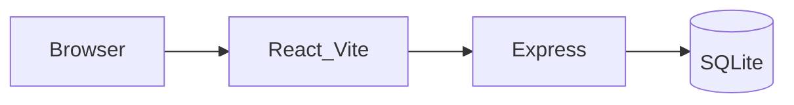

# Application architecture

The architecture stays inside the learning curriculum: React, TypeScript, Tailwind CSS, Node.js, Express, and SQLite. Git holds the history. Tests come with the first workflow, in small pieces, so a rule can be checked without a large test framework discussion on day one.

No message bus, no separate AI database, no container platform, and no second backend are part of this design. Those tools solve problems this project does not have yet.

## What each piece is for

- **React and TypeScript, with Vite as the development server.** The browser application. TypeScript is how the project says what shape a finding or a risk result has, so a misspelled field is caught before the page runs. Vite is the ordinary way to run a React project locally. It is a tool, not a new architectural layer.
- **Tailwind CSS.** Styling in the markup, so time goes to the workflow rather than a separate design system.
- **Express on Node.js.** The only place that reads and writes data, checks roles, computes the risk matrix, and, later, calls Grok.
- **SQLite.** One file database. It is enough for one fictional garrison and for learning how tables relate. The SQL is visible. Nothing in the learning path requires a database server.
- **A small `shared` folder.** TypeScript types used by both the browser and the server: probability codes, severity codes, risk levels, and record statuses. One definition prevents the screen and the server from inventing different names for “extremely high.”

Proposed folders, when implementation is later approved:

```text
client/     React, TypeScript, Tailwind
server/     Express, TypeScript, SQLite access
shared/     types used by client and server
docs/       these research notes
```

## Request path

The browser never opens the database and never holds the xAI API key. It sends an HTTP request to Express. Express checks the session and the organization, reads or writes SQLite, and returns JSON.



Evidence files, when the workflow reaches them, sit in a folder on disk. The database stores the file name, the record it belongs to, and a hash. The server checks role and organization before it sends the file.

A later Grok call is another outbound request from Express only. It is drawn in the [security note](09-security-ai-governance.md). It is not part of the first milestone’s running path.

## Where rules live

Business rules live in server functions, not only in the buttons on the page. The page can hide a button. A hidden button is not the control. The server rejects a status change that the workflow does not allow.

Each status change appends a `record_event` row: what changed, who did it, and when. The previous finding text stays.

The doctrinal matrix is data: twenty rows of probability, severity, and level, each commented with the ATP 5-19 paragraph that states it (1-45 through 1-48). The server looks up the row. It does not average numbers, and it does not accept a level that is not the lookup result.

Risk-acceptance authority is a second table, loaded only from transcribed and checked cells of DA Pam 385-30 Table 4-1. Missing cells are not filled with a reasonable guess. A decision against a missing cell is stored as blocked.

## What the first running system contains

Enough to complete the [workflow](08-workflow.md):

- Organizations, users, and roles for Camp Sentinel.
- Inspections, observations, findings, hazards.
- Risk assessments that store estimates and matrix results.
- Risk decisions and authority checks as separate records.
- Controls, corrective actions, evidence metadata, and verifications.
- A short audit trail.
- Tests for the twenty matrix cells and for one rejected self-verification.

Screens stay few: a list, a finding, and the assessment and action steps. Visual polish waits.

## What is intentionally absent

- Official ASOHMS criterion text and any screen that could be read as an Army rating.
- Environmental, occupational health, council dashboard, and AI modules. The shared types may reserve a program-area field on a finding so those modules can attach later. That field can stay unused.
- Override, waiver, delegation, and “set the level anyway” functions.
- Login integration with Army identity systems.

## How a learner should read this design

The browser is the workshop window. Express is the clerk who applies the rules. SQLite is the filing cabinet. Doctrine does not live in the window. It lives in the clerk’s checks and in the matrix table, with a paragraph number next to each cell so the filing rule can be audited.
