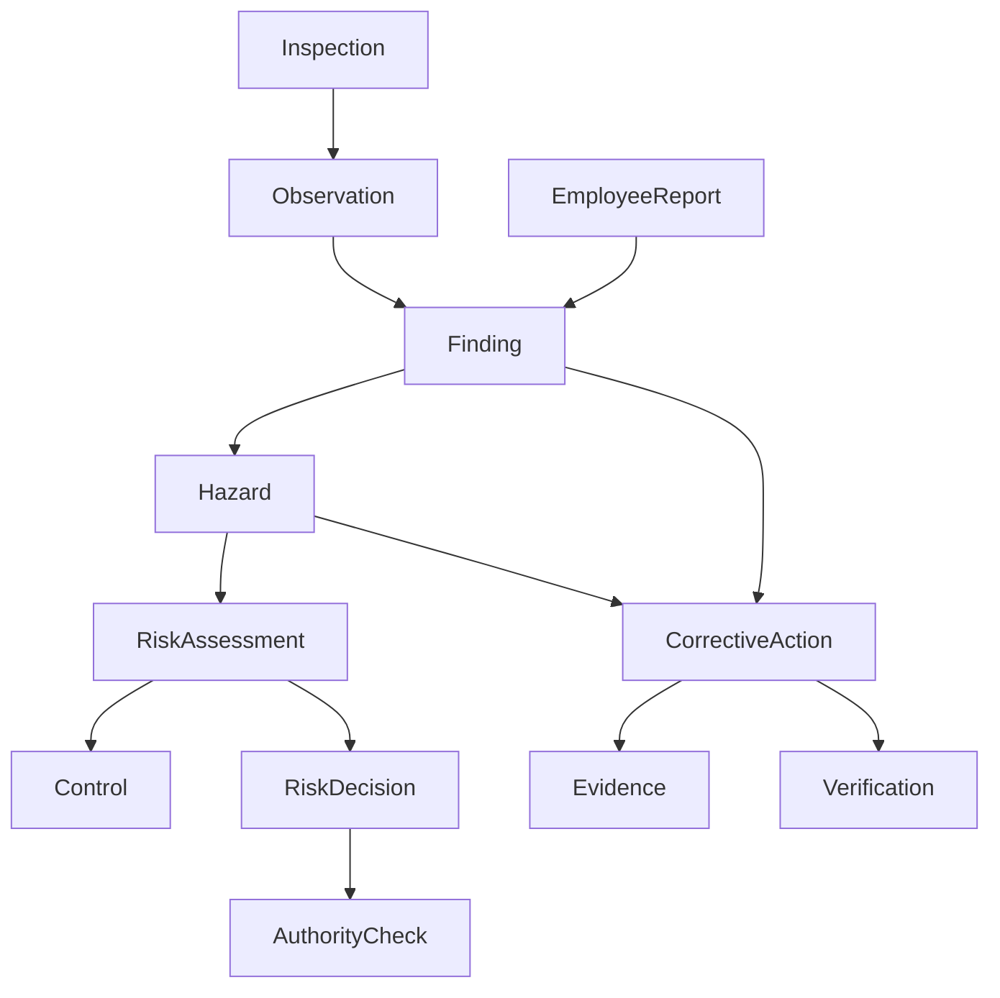

# Data model

This is the proposed SQLite model for the first milestone, plus a few unused fields so later capabilities do not require a redesign. Table names are plain. No database will be created during the documentation phase.

Every business row carries `id`, `organization_id`, `created_at`, and `created_by`. Status changes are also written to `record_event`. Updating a row does not destroy the prior version of a finding narrative. The narrative is inserted once and left in place. Corrections are new rows that point at the prior row.

## Organizations and access

- **organization.** Garrison, unit, or shop. `parent_id` points at the parent organization. Camp Sentinel is the root in the seed data. The two tenant units are children.
- **user.** Login identity for the demo. Password hash only. No personal medical fields.
- **role** and **user_role.** A role is granted inside one organization. The first milestone uses employee, supervisor, safety officer, commander, and administrator.

A `person` table is not required for the first milestone. Findings can name a duty position and a shop (“equipment operator, Shop 2”) without creating an identity that looks like a medical patient.

## The core records

- **inspection.** Date, shop, inspector. Status moves from draft to complete. Completing an inspection does not close its findings.
- **observation.** What was seen, in the inspector’s words, tied to one inspection.
- **employee_report.** A written report that may have no inspection. Optional reporter display name. Shared views can hide the name.
- **finding.** The deficiency statement. `original_text` is immutable. `source_observation_id` or `source_report_id` records where it came from. Optional `program_area` is null in the first milestone and reserved for a later environmental finding. Status describes the finding’s life (open, action in progress, action closed). Status is not a delete flag.
- **hazard.** A condition that can cause a loss. A finding links to a hazard. The hazard remains when the finding’s action is closed, because the condition and the historical finding are different facts. One hazard can be linked from more than one finding.
- **risk_assessment.** One row per assessment event on a hazard.
  - `phase` is `initial` or `residual`.
  - `probability_code` is A, B, C, D, or E.
  - `severity_code` is I, II, III, or IV.
  - `matrix_level` is the lookup result: extremely high, high, medium, or low.
  - `matrix_cell` stores the combination, such as IIA, and `doctrine_ref` stores the ATP 5-19 paragraph that states that cell.
  - `estimated_by` is the person who chose the probability and severity.
  - There is no column for a user-supplied level that differs from `matrix_level`.
- **control.** Tied to the residual assessment. `atp_category` is educational, physical, or hazard elimination (ATP 5-19 paragraph 1-50). `hierarchy_step` is elimination, substitution, engineering, administrative, or PPE when the industrial hierarchy in AR 385-10 paragraph 6-5 applies. `what_text`, `who_text`, and `how_text` are required.
- **risk_decision.** A separate row. `decision` is accept or reject. `decided_by`, `grade_text`, `duration_text`, and `public_exposed` are stored. This row does not update `matrix_level`.
- **authority_check.** A separate row on that decision. `result` is allowed or blocked. `basis` is either a verified Table 4-1 cell identifier or the text “authority cell not verified.” A blocked result is a normal, stored outcome.
- **corrective_action.** What will be done, owner, due date, status. `finding_id` and `hazard_id` are both kept. `kind` is corrective or preventive. Preventive actions are allowed by the model and not required for the first story.
- **evidence.** File name, hash, action id, uploaded by, uploaded at.
- **verification.** Pass or fail, verifier, notes, time. A failed verification inserts a follow-on action status and leaves the failed verification row in place.

## Lookup tables that are doctrine, not decoration

- **risk_matrix_cell.** Twenty rows. Seeded only from ATP 5-19 paragraphs 1-45 through 1-48, with the paragraph number on the row. Tests read this table.
- **risk_acceptance_cell.** Seeded only after a checked transcription. Empty cells are not wildcards that mean “anyone may accept.”

A risk assessment code (RAC) crosswalk from DA Pam 385-30 Table 3-4 can be a later column on the matrix cell: extremely high = 1, high = 2, medium = 3, low = 4. The low row needs one more look at the printed table before that column is trusted. The first milestone can show the ATP level words without the RAC number.

## History

- **record_event.** `record_type`, `record_id`, `from_status`, `to_status`, `actor_user_id`, `created_at`, `reason`. Insert only.

Closing a corrective action writes an event on the action and an event on the finding. It does not update `finding.original_text`.

## Reserved for later, not built in the first milestone

These names are here so the core tables do not have to be broken apart later. Obligation, waste stream, spill, exposure group, the ASOHMS practice tables, and the AI tables are now used. Mishap stays empty.

- **mishap.** Class code, once DA Pam 385-40 is transcribed. Link to hazard and to finding.
- **obligation**, **waste_stream**, **spill.** These records are in use. An obligation stores the duty and where it applies. A waste stream stores the recorded distinction between subtitle C waste and other waste. A spill stores what happened and who it was reported to. Each one can open a finding on the existing action path. There is no column for a compliance determination. A spill does not point at a mishap until that record exists.
- **exposure_group.** In use. Agent, shop, control method, headcount, and exam-completion percent. A field that is not one of those five is rejected. No person-level result column is part of the design.
- **asohms_objective.** In use. The six internal codes and the source labels from the [mapping note](03-asohms-mapping.md).
- **asohms_criterion.** In use. `official_text` stays null. `placeholder_note` says the official sentence is not loaded. The practice response returns that note as a placeholder and does not copy it into `officialText`.
- **asohms_score.** In use. One practice status per organization and objective: not started, in progress, or complete. `stage_label` is an optional name. `is_official_assessment` is not a column. The absence of that column is deliberate. There is nothing to set to true.
- **source_document.** In use. A card from the source register: publication, citation, review status, review date, the statement that was read, and the product limit. An unresolved card stays unresolved.
- **ai_exchange.** In use. The user, the question, the record ids that were sent, the source ids that were sent, and the reply. The reply is text. It is not applied to a finding, a decision, or an action.

## Relationships worth remembering

An inspection has many observations. An observation has findings. A finding has one original text and may have many actions over time. A hazard has many assessments. An assessment has one matrix result. A decision refers to one residual assessment and has one authority check. Verification refers to one action and does not delete it.

That chain is the product. Extra programs hang from finding, hazard, and action. They do not replace the chain.
